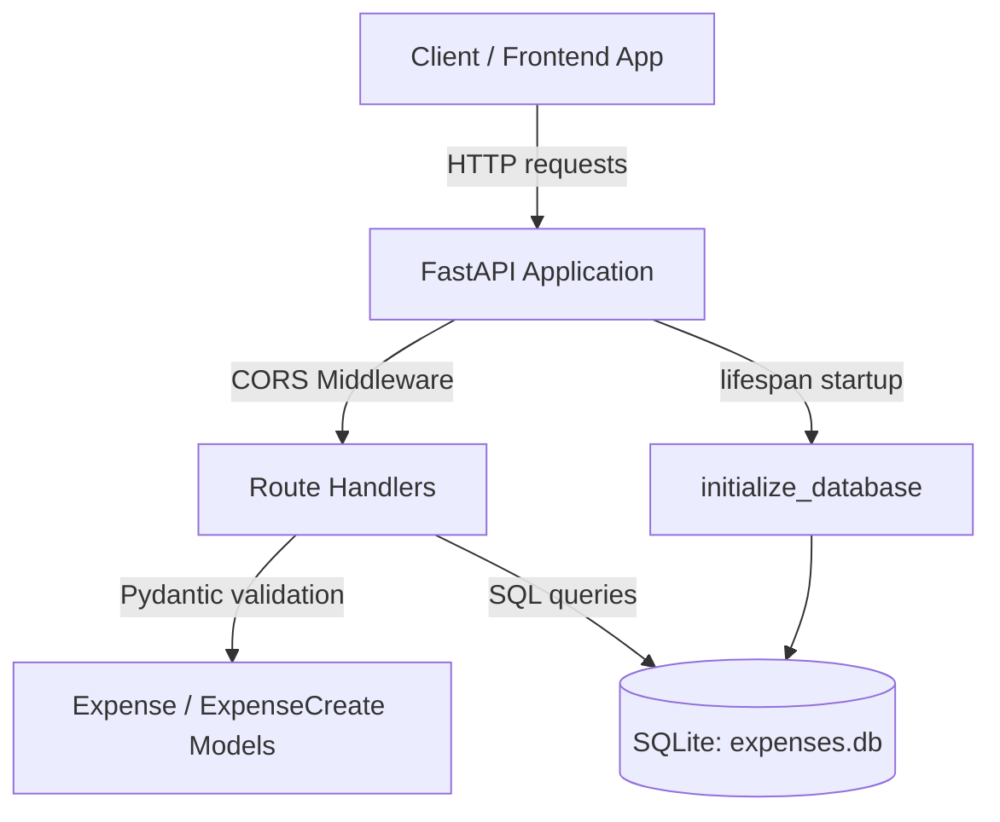
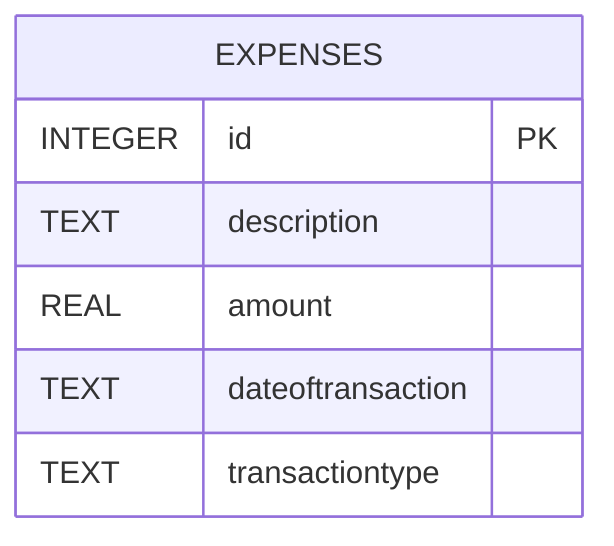
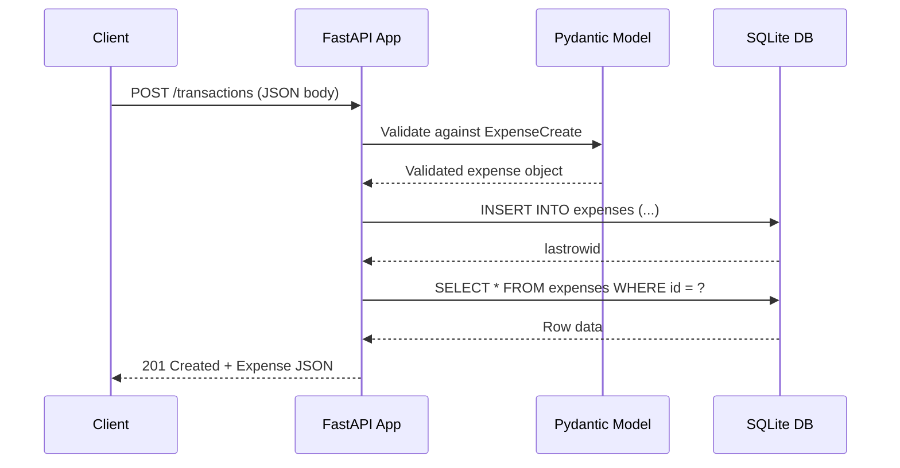

# Expense Tracker Backend

A lightweight REST API for tracking personal expenses and income, built with **FastAPI** and **SQLite**. It exposes a simple CRUD interface over a single `expenses` resource (referred to as "transactions" in the API) and is designed to be consumed by a frontend client (e.g., a web or mobile expense tracker UI).

---

## Table of Contents

- [Description](#description)
- [Tech Stack](#tech-stack)
- [Dependencies](#dependencies)
- [Folder Structure](#folder-structure)
- [Architecture](#architecture)
- [Database Schema](#database-schema)
- [Application Flow](#application-flow)
- [API Endpoints](#api-endpoints)
- [Data Models](#data-models)
- [Setup & Running Locally](#setup--running-locally)
- [Configuration](#configuration)
- [Error Handling](#error-handling)
- [CORS Policy](#cors-policy)

---

## Description

The Expense Tracker Backend is a minimal, single-file FastAPI service that allows clients to create, read, update, and delete financial transactions (expenses or income entries). Each transaction records a description, amount, date, and transaction type (e.g., `expense` or `income`). Data is persisted in a local SQLite database file, making the service easy to run without any external database setup.

Key characteristics:
- **Zero external infra** — uses SQLite (file-based), no separate DB server required.
- **Auto-initializing schema** — the `expenses` table is created automatically on startup if it doesn't exist.
- **CORS enabled for all origins** — ready to be consumed by any frontend during development.
- **Typed request/response models** via Pydantic, with automatic OpenAPI/Swagger docs generated by FastAPI.

---

## Tech Stack

| Layer              | Technology                                    |
|---------------------|------------------------------------------------|
| Language            | Python 3                                        |
| Web Framework       | [FastAPI](https://fastapi.tiangolo.com/) 0.162.0 |
| ASGI Server         | [Uvicorn](https://www.uvicorn.org/) 0.54.0 (standard extras) |
| Data Validation     | [Pydantic](https://docs.pydantic.dev/) 2.14.3   |
| Database            | SQLite (via Python's built-in `sqlite3` module) |
| Virtual Environment | `venv` (`myenv/`)                               |

FastAPI automatically provides interactive API documentation via:
- Swagger UI: `http://localhost:8000/docs`
- ReDoc: `http://localhost:8000/redoc`
- OpenAPI schema: `http://localhost:8000/openapi.json`

---

## Dependencies

Declared in [requirements.txt](requirements.txt):

```
fastapi
uvicorn[standard]
```

Transitive/runtime dependencies installed in the virtual environment (`myenv/`) include:

| Package            | Purpose                                              |
|---------------------|-------------------------------------------------------|
| `starlette`         | ASGI toolkit underlying FastAPI                       |
| `pydantic` / `pydantic_core` | Data validation and settings management       |
| `typing_extensions`, `typing_inspection`, `annotated_types`, `annotated_doc` | Typing support for Pydantic models |
| `anyio`             | Async concurrency abstraction used by Starlette        |
| `click`             | CLI toolkit used by Uvicorn                            |
| `h11`               | HTTP/1.1 protocol implementation for Uvicorn            |
| `httptools`         | Fast HTTP parsing (Uvicorn "standard" extra)            |
| `idna`              | Internationalized domain name support                   |
| `watchfiles`        | File-change detection for `--reload` dev mode            |
| `websockets`        | WebSocket support (Uvicorn "standard" extra)              |
| `python-dotenv`     | `.env` file loading support                              |
| `pyyaml`            | YAML parsing (used by some Uvicorn config options)        |
| `opentelemetry-api` | Observability/tracing instrumentation hooks               |
| `pip`               | Package management                                        |

No ORM is used — the application interacts with SQLite directly through Python's standard `sqlite3` module.

---

## Folder Structure

```
expense-tracker-backend/
├── main.py                # Application entry point: models, DB logic, API routes
├── requirements.txt        # Python package dependencies
├── expenses.db             # SQLite database file (auto-created at runtime)
├── README.md                # Project documentation (this file)
├── __pycache__/             # Python bytecode cache (auto-generated)
└── myenv/                   # Python virtual environment
    ├── Scripts/              # Activation scripts (Windows)
    └── Lib/site-packages/    # Installed third-party packages
```

Since this is a small service, all application logic (models, DB access, routes, startup/shutdown hooks) is intentionally kept in a single [main.py](main.py) module rather than split across packages.

---

## Architecture

The application follows a simple **layered, single-process, monolithic API** architecture:



**Components:**

1. **FastAPI app instance** (`app`) — the central ASGI application, configured with a `lifespan` context manager and CORS middleware.
2. **Lifespan hook** (`lifespan`) — runs `initialize_database()` once on application startup to ensure the `expenses` table exists.
3. **Connection management** (`get_connection`) — a context-managed generator that opens a SQLite connection per request, commits on success, and always closes the connection (even on error).
4. **Pydantic models** (`Expense`, `ExpenseCreate`) — define the request and response schemas and perform automatic type validation/coercion (e.g., parsing ISO date strings into `date` objects).
5. **Route handlers** — five endpoints implementing full CRUD over the `expenses` table.

There is no authentication, authorization, caching, or external service integration — this is a minimal, self-contained CRUD API suitable for a single-user or demo/learning project.

---

## Database Schema

Single table, created automatically on startup:

```sql
CREATE TABLE IF NOT EXISTS expenses (
    id INTEGER PRIMARY KEY AUTOINCREMENT,
    description TEXT NOT NULL,
    amount REAL NOT NULL,
    dateoftransaction TEXT NOT NULL,
    transactiontype TEXT NOT NULL
)
```

### Entity-Relationship Diagram



**Column notes:**
- `id` — auto-incrementing primary key.
- `description` — free-text label for the transaction.
- `amount` — numeric value of the transaction (stored as `REAL`).
- `dateoftransaction` — stored as an ISO-8601 date string (`YYYY-MM-DD`), parsed to/from Python's `date` type at the API boundary.
- `transactiontype` — a string indicating the kind of transaction (e.g., `"expense"` or `"income"`); not constrained by a DB-level enum/check constraint.

There is only one table — no foreign keys or relationships exist in this schema.

---

## Application Flow

1. **Startup**: Uvicorn loads `main.py`, FastAPI triggers the `lifespan` context manager, which calls `initialize_database()` to create the `expenses` table if it doesn't already exist.
2. **Request handling**: For each incoming HTTP request, FastAPI routes it to the matching handler function based on path and method.
3. **Validation**: Incoming JSON bodies are parsed and validated against the `ExpenseCreate` Pydantic model (for POST/PUT), raising a `422 Unprocessable Entity` automatically on validation failure.
4. **Database access**: The handler opens a SQLite connection via `get_connection()`, executes the relevant SQL statement(s), and the context manager commits the transaction and closes the connection afterward.
5. **Response**: Rows are converted to dictionaries and parsed into the `Expense` response model, which FastAPI serializes to JSON.
6. **Error cases**: If a transaction ID is not found (GET/PUT/DELETE by ID), the handler raises `HTTPException(status_code=404)`.

### Request Sequence (example: Create Transaction)



---

## API Endpoints

Base URL (default local run): `http://localhost:8000`

| Method | Path                        | Description                          | Request Body    | Success Response        |
|--------|-----------------------------|---------------------------------------|------------------|--------------------------|
| POST   | `/transactions`              | Create a new transaction              | `ExpenseCreate`   | `201 Created` → `Expense` |
| GET    | `/transactions`              | List all transactions (newest first)  | —                | `200 OK` → `Expense[]`    |
| GET    | `/transactions/{transaction_id}` | Get a single transaction by ID    | —                | `200 OK` → `Expense`      |
| PUT    | `/transactions/{transaction_id}` | Update an existing transaction    | `ExpenseCreate`   | `200 OK` → `Expense`      |
| DELETE | `/transactions/{transaction_id}` | Delete a transaction              | —                | `204 No Content`          |

Additional auto-generated FastAPI routes:
- `GET /docs` — Swagger UI
- `GET /redoc` — ReDoc UI
- `GET /openapi.json` — OpenAPI schema

### Endpoint Details

#### `POST /transactions`
Creates a new expense/income record.

Request body example:
```json
{
  "description": "Groceries",
  "amount": 45.99,
  "dateoftransaction": "2026-11-05",
  "transactiontype": "expense"
}
```

Response: `201 Created`
```json
{
  "id": 1,
  "description": "Groceries",
  "amount": 45.99,
  "dateoftransaction": "2026-11-05",
  "transactiontype": "expense"
}
```

#### `GET /transactions`
Returns all transactions ordered by `dateoftransaction DESC, id DESC`.

#### `GET /transactions/{transaction_id}`
Returns a single transaction. Returns `404 Not Found` with `{"detail": "Transaction not found"}` if no matching ID exists.

#### `PUT /transactions/{transaction_id}`
Replaces all fields of an existing transaction. Returns `404 Not Found` if the ID doesn't exist.

#### `DELETE /transactions/{transaction_id}`
Deletes a transaction by ID. Returns `204 No Content` on success, or `404 Not Found` if the ID doesn't exist.

---

## Data Models

### `ExpenseCreate` (request model)
| Field               | Type   | Required | Notes                                  |
|----------------------|--------|----------|------------------------------------------|
| `description`         | `str`  | Yes      | Free-text description                    |
| `amount`              | `float`| Yes      | Transaction amount                       |
| `dateoftransaction`   | `date` | Yes      | ISO-8601 format (`YYYY-MM-DD`)            |
| `transactiontype`     | `str`  | Yes      | e.g. `"expense"` or `"income"`             |

### `Expense` (response model)
Same as `ExpenseCreate`, plus:
| Field | Type  | Notes                      |
|-------|-------|------------------------------|
| `id`  | `int` | Auto-generated primary key   |

---

## Setup & Running Locally

### Prerequisites
- Python 3.10+ installed
- Windows PowerShell (or any shell)

### Steps

```powershell
# 1. Navigate to the project directory
cd expense-tracker-backend

# 2. Create/activate the virtual environment (already present as myenv/)
./myenv/Scripts/Activate.ps1

# 3. Install dependencies
pip install -r requirements.txt

# 4. Run the development server
uvicorn main:app --reload
```

The API will be available at `http://127.0.0.1:8000`, with interactive docs at `http://127.0.0.1:8000/docs`.

---

## Configuration

| Environment Variable | Default                           | Purpose                                             |
|------------------------|------------------------------------|--------------------------------------------------------|
| `EXPENSE_DB_PATH`       | `<project_dir>/expenses.db`        | Overrides the path to the SQLite database file.         |

Example (PowerShell):
```powershell
$env:EXPENSE_DB_PATH = "C:\data\expenses.db"
uvicorn main:app --reload
```

---

## Error Handling

| Scenario                                 | HTTP Status             | Response Body                              |
|--------------------------------------------|---------------------------|-----------------------------------------------|
| Transaction ID not found (GET/PUT/DELETE)   | `404 Not Found`            | `{"detail": "Transaction not found"}`          |
| Invalid/missing request fields              | `422 Unprocessable Entity` | FastAPI/Pydantic validation error details       |

---

## CORS Policy

CORS is currently configured to allow **all origins, methods, and headers**:

```python
app.add_middleware(
    CORSMiddleware,
    allow_origins=["*"],
    allow_methods=["*"],
    allow_headers=["*"],
)
```

> **Note:** This is convenient for local development but should be restricted to specific trusted origins before deploying to production.
